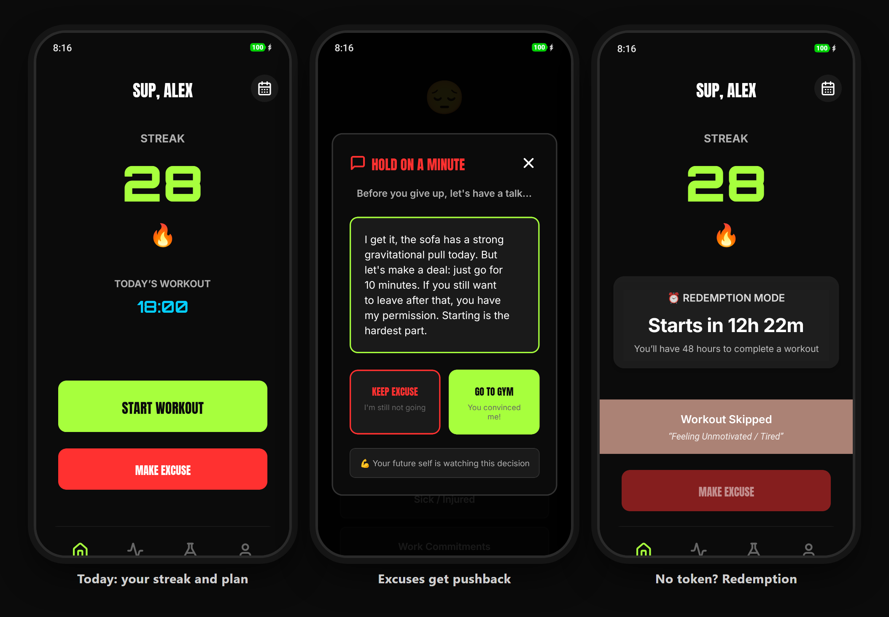
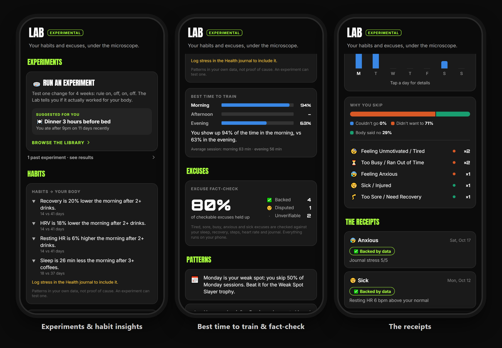
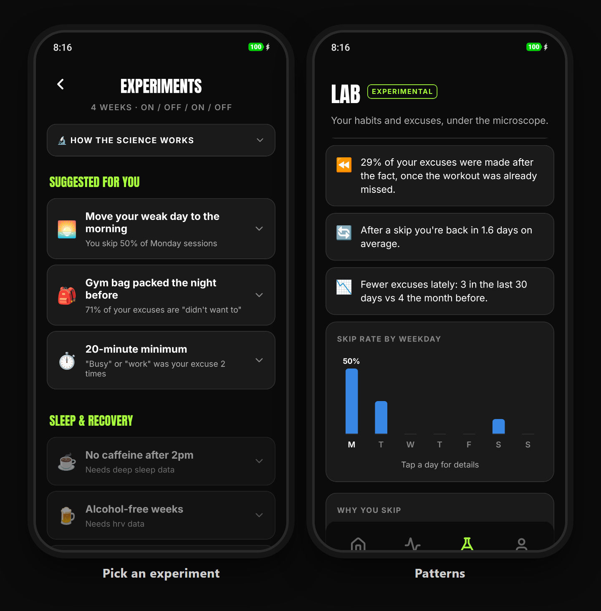
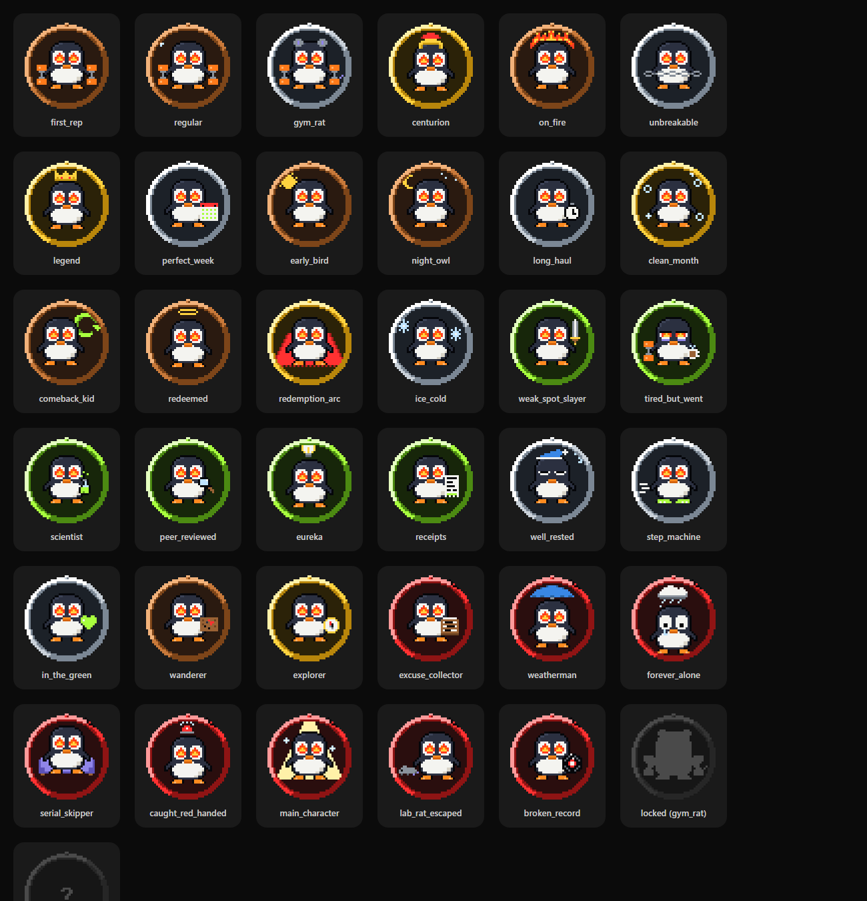
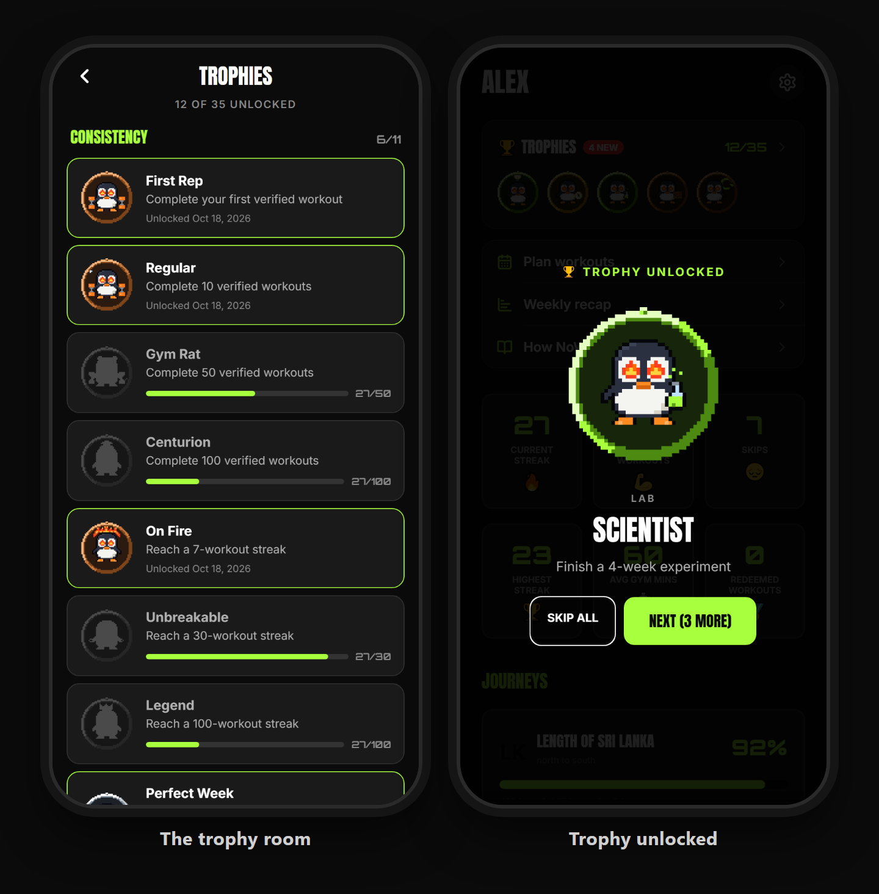
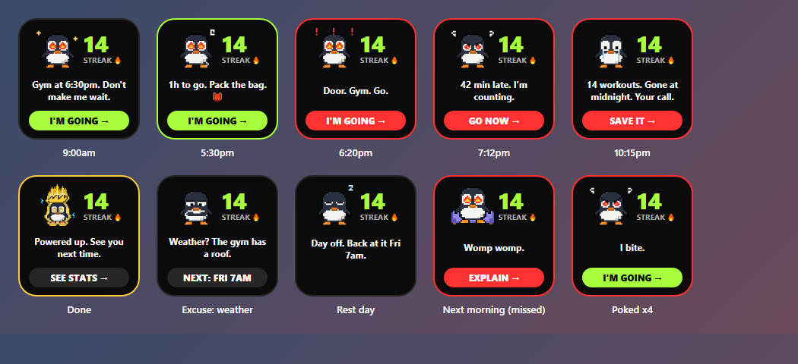
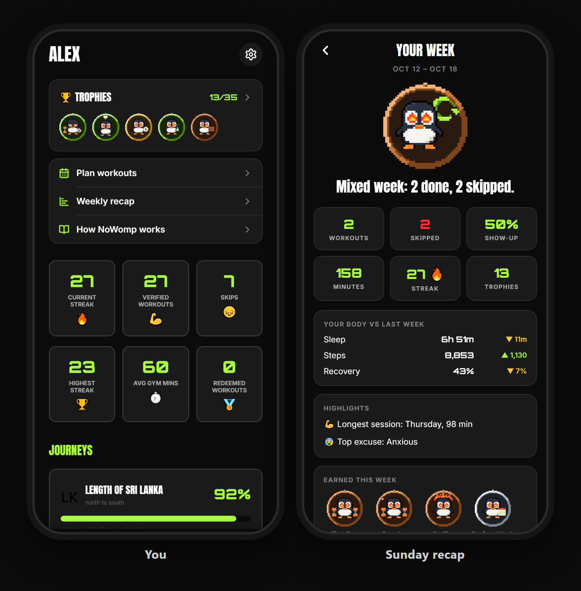
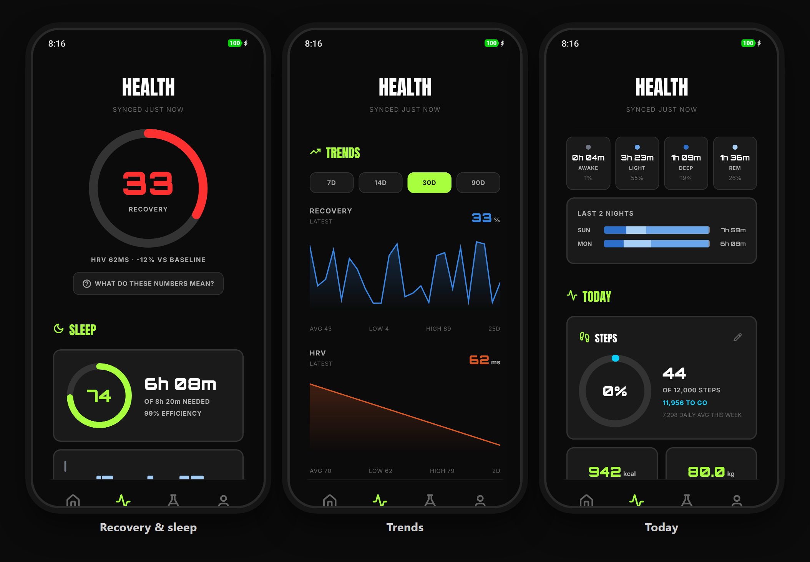

<div align="center">


# NoWomp

**The gym accountability app that doesn't let you off the hook.**

Schedule it. Show up. Or explain yourself, and let your own body fact-check the excuse.

[](LICENSE)
[](#install)
[](https://expo.dev)
[](https://reactnative.dev)
[](tsconfig.json)
[](#privacy)
[](CHANGELOG.md)
[](CONTRIBUTING.md)

[](https://github.com/akashkashyaps/nowomp/actions/workflows/checks.yml)
[](https://github.com/akashkashyaps/nowomp/releases)
[](https://github.com/akashkashyaps/nowomp/stargazers)
[](https://github.com/akashkashyaps/nowomp/issues)

[**Get it on Google Play**](https://play.google.com/store/apps/details?id=com.nowomp.app) · [**Watch the 44-second trailer**](https://youtube.com/shorts/5uVNBghiBmc)

[**Why NoWomp**](#why-nowomp) · [**Get started**](#get-started) · [**Features**](#features) · [**Privacy**](#privacy) · [**For developers**](#for-developers) · [**Money**](#will-i-make-money-from-this)

</div>

---

## Why NoWomp

### The name

*Womp womp* is the sad-trombone "wah-wah" that plays when someone fails. It's the losing horn from old game shows like *The Price Is Right* and SNL's *Debbie Downer*, and online it's what you say to someone's sorry excuse: "I was going to go to the gym, but… womp womp."

**NoWomp** means exactly that: don't womp womp. Don't whine, don't make excuses, just get it done.

### Why I built it

Fitness tracking used to be fun. Apps had journeys to follow, trophies to chase and colour everywhere. Over time, the popular ones went corporate. The fun features were removed or buried, and what's left is plain numbers on a grey screen. Now AI is pushed in your face too: it's the main screen of many apps, and the interesting stuff is hidden somewhere inside.

Privacy worries me just as much. These apps hold your workouts, your sleep, your heart rate and your health history on their servers. People have reported seeing ads that match their medical data. That should never happen, and I don't want to build anything that could let it.

And no app I tried put **accountability** at its centre. Most reward you for showing up and quietly forget the days you don't. But the days you don't are where habits actually break.

So NoWomp is built around three ideas:

1. **Accountability is the core.** Workouts are scheduled and checked against your location. Skipping is allowed, but never silent. Excuses get fact-checked against your own body data.
2. **The fun comes back.** Pixel-art trophies, a penguin widget with moods, a pixel power-up celebration when you finish, streaks and journeys. It's all in plain sight, not hidden behind menus.
3. **Your data is yours.** Everything stays on your phone. No account, no server, no analytics, no ads. The app never talks to an AI. If you want AI help, it copies a prompt for you to paste wherever you choose.

It's for the gym, home workouts, sports, or anything you schedule and want to actually show up for.

## Get started

### Just want to use it?

You don't need to know anything about code.

1. **Install the app.** It's free on [Google Play](https://play.google.com/store/apps/details?id=com.nowomp.app). Other options are under [Install](#install).
2. **Add your places.** On first launch, add where you train: your gym, your home, or where you play sport. Search for it or drag the map to it. Sessions only count when you start them at one of your places.
3. **Plan your week.** Tap the 📅 button on Today and pick your workout days and times. Only scheduled days count, so rest days never hurt your streak.
4. **Show up.** Tap **START WORKOUT** when you arrive and **END WORKOUT** when you're done. NoWomp works out from where you are whether it's a workout or sport.
5. **Can't make it? Say so.** Tap **MAKE EXCUSE** before you skip. If you miss a workout without a word, the app asks why the next time you open it.
6. **Optional extras:**
   - Connect **Health Connect** in the Health tab for sleep, recovery and excuse fact-checks.
   - Add the **penguin widget** to your home screen.
   - On Xiaomi, Samsung and similar phones, follow the **background reliability** card in You, so reminders aren't killed.

A short guided tour runs the first time you open each tab. The full rules live in **You → How NoWomp works**, and you can replay the tours from Settings.

### Developer?

NoWomp is fully open source under the AGPLv3. You can:

- **Build it yourself** and run it on your own phone, with no account or store needed.
- **Fork it** and make it your own, as long as your version stays open source too (see [License](#license)).
- **Contribute** features, fixes, new trophies, new experiment templates or translations.
- **Reuse the ideas.** The Lab's analysis, the experiment statistics and the widget's mood logic are plain TypeScript functions you can read and test without a phone.

Everything you need is in [For developers](#for-developers).

## Features

### 🔥 Accountability

This is the heart of the app. Your **streak** only grows from real, location-checked workouts.

- **Scheduled, verified sessions.** Start and end them at one of your places. Each one is timed and saved as verified.
- **Gym, home and sport.** Save up to 10 named places, picked on a map. Gym and home sessions are workouts. A sport session (football, badminton, climbing…) keeps your streak alive too, but is counted on its own in your stats.
- **Excuses, not silence.** You can skip a day, but you have to say why. Miss a workout without a word and the app locks until you explain yourself, within 24 hours.
- **Freeze tokens.** Every time your streak hits a multiple of 15, you earn a token that absorbs one excuse. You can hold up to 5.
- **Redemption.** No token? You get one chance a week to save your streak by completing a redemption workout within 48 hours. You can't make excuses while a redemption is active.
- **Plain-words rules.** Every rule is explained in one place, in the app.

<div align="center">

</div>

### 🧪 The Lab

The Lab turns your own history into honest answers.

- **Excuse fact-check.** Said you were too tired? NoWomp checks last night's sleep and this morning's recovery. *"You said 'too tired' but slept 8h 12m with 84% recovery. 🤨"* Tired, sore, busy, anxious and sick excuses are checked against sleep, recovery, steps, heart rate and your journal. Anxiety, illness and emergencies are never called lies.
- **Patterns.** Your weakest weekday and time slot, how you slept before skips, and how fast you bounce back.
- **Habits → body.** How drinks, caffeine, late dinners and stress show up in the next morning's HRV, resting heart rate, sleep and recovery.
- **Best time to train.** Your show-up rate by time of day.
- **The receipts.** Every excuse you've made, in one list.

<div align="center">

</div>

### 🔬 Self-experiments

Want to know if something actually works for *you*? Run a proper experiment on yourself.

- **4 weeks, rule on and off.** Each experiment follows the rule for a week, drops it for a week, then repeats, starting in a random order. You pick the main measure up front, check in daily, and the result stays locked until the end.
- **No false wins.** A result only counts if the difference beats your own day-to-day ups and downs *and* shows up in both rule-on weeks.
- **A library to start from.** 12 templates, suggested from your own data, or design your own.
- **Optional AI help.** The app can copy a prompt for ChatGPT or Claude. Paste the reply back, or tap the link it gives you, to load the experiment. The app itself never calls an AI.

<div align="center">

</div>

### 🏆 Trophies

35 pixel-art penguin medals to collect: bronze, silver and gold for showing up, Lab trophies for experimenting, and a hidden **Hall of Shame** for the excuse-makers. Each one unlocks with its own celebration.

<div align="center">

<br /><br />

</div>

### 📱 Home-screen widget

A penguin whose mood follows your day: hyped in the morning, impatient as the session nears, furious when you're late, and crying at 9pm when the streak is genuinely at risk. Poke him and he gets annoyed. It works at the small 1×1 size too.

<div align="center">

</div>

### 🙋 You and the weekly recap

- **You** shows your streaks, records, trophies, journey and settings in one place.
- **Every Sunday**, a recap of your week: workouts done, excuses made, how you slept and what's coming up.

<div align="center">

</div>

### ❤️ Health (via Health Connect)

Recovery and sleep scores, worked out on your phone from HRV, resting heart rate and sleep stages. Plus steps, heart-rate zones, trends and a daily journal.

**No watch? No problem.** Workouts, excuses, streaks, trophies and the widget all work on the phone alone. A fitness watch (Fitbit, Samsung, Garmin, Pixel Watch…) adds sleep, recovery and the excuse fact-check, through Health Connect. Recovery scores calibrate to you over your first 7 days.

<div align="center">

</div>

## Install

| Channel | Status |
|---|---|
| Google Play | [NoWomp: Stop Skipping Gym](https://play.google.com/store/apps/details?id=com.nowomp.app) |
| GitHub Releases (APK) | [Latest release](https://github.com/akashkashyaps/nowomp/releases/latest) |
| Build it yourself | [See below](#build-from-source) |

The GitHub APK and the Play version are signed with different keys, so you can't update one with the other. To switch, export a backup in Settings, uninstall, install the other and restore.

**Requirements:** Android 8.0 or newer. Health features need [Health Connect](https://play.google.com/store/apps/details?id=com.google.android.apps.healthdata). iOS isn't supported, because Health Connect is Android-only.

## Privacy

NoWomp has **no backend**. All your data lives in a database on your phone.

- No account, no analytics, no tracking, no ads, no third-party data SDKs.
- The only network use is the map when you add a place: map images come from OpenStreetMap, and place searches go to its search service. Your saved places never leave the phone.
- Health Connect data is read on your phone and never leaves it.
- Backups are a file *you* export and keep wherever you choose.
- AI features only ever copy text to your clipboard. You decide where to paste it.

Full details: [Privacy Policy](docs/privacy-policy.txt).

## Will I make money from this?

Honestly: probably, someday. I haven't worked out how yet. But I want to be upfront about what that means:

- **Everything in this repo is free, and stays free.** Whatever you see here today will never be put behind a paywall.
- **Any paid extras would most likely be server-based features**, like sync between devices, that cost money to run. The offline app keeps working without them.
- **It's open source**, so you can always build it yourself or install an earlier version. Nothing I do later can take away what's already here.
- **The core principles won't change:** accountability first, the fun in plain sight, and your data on your phone.

## For developers

### Build from source

**You'll need:**
- **Node.js 22** and npm
- **JDK 17** (the one bundled with Android Studio works)
- **Android SDK** (API 36), via Android Studio
- An Android phone with USB or wireless debugging, or an emulator

**Run in development:**
```bash
git clone https://github.com/akashkashyaps/nowomp.git
cd nowomp
npm install
npx expo run:android     # builds the native app and starts Metro
```
The web preview (`npx expo start --web`) is handy for UI work, but Health Connect, location, notifications, sounds and the widget only work in a real Android build.

**Build a release APK:**
```bash
cd android
./gradlew assembleRelease -PreactNativeArchitectures=arm64-v8a
adb install -r app/build/outputs/apk/release/app-release.apk
```
Without a release keystore, the build falls back to the debug key, which is fine for your own phone. To sign it properly, set `NOWOMP_UPLOAD_STORE_FILE`, `NOWOMP_UPLOAD_STORE_PASSWORD`, `NOWOMP_UPLOAD_KEY_ALIAS` and `NOWOMP_UPLOAD_KEY_PASSWORD` in `~/.gradle/gradle.properties`. Never commit a keystore.

**Testing tools:** tap **Version** in Settings five times to open the developer panel. It can fill the app with realistic test data.

**Checks:**
```bash
npx tsc --noEmit     # typecheck
npx expo lint        # lint
```

### Project structure

```
app/                 Screens (expo-router: the file path is the route)
  (tabs)/            Today, Health, Lab, You
components/          Reusable UI: tour, celebration, pixel badges, cards
constants/           Theme, excuse list, trophy and experiment definitions, pixel art
services/            All logic and data access (SQLite via expo-sqlite)
database/            Schema and migrations
widgets/             Home-screen widget (react-native-android-widget)
assets/sounds/       8-bit sounds, generated by scripts/generate-sounds.py
android/             Native project, including the workout foreground service
docs/                Privacy policy, publishing checklist, images
```

A few design rules hold across the code:
- **Pure analysis, separate from loading.** The Lab, experiment and widget-mood logic are plain functions that can be tested without a device.
- **Everything offline.** If a feature needs the network, it doesn't belong in the core app.
- **Honest numbers.** Every verdict has to beat the user's own noise before the app claims anything.

### Contributing

Contributions are welcome. Please read [CONTRIBUTING.md](CONTRIBUTING.md) first. In short:

1. Open an issue to discuss anything bigger than a small fix.
2. Keep the typecheck and lint clean.
3. Sign off your commits with `git commit -s` ([DCO](https://developercertificate.org/)). There's nothing to sign.

Everyone taking part is expected to follow the [Code of Conduct](CODE_OF_CONDUCT.md).

## Roadmap

- [x] Google Play release
- [x] GitHub Releases APK
- [ ] F-Droid listing
- [ ] Optional end-to-end-encrypted sync between devices, self-hostable

Ideas and bug reports are welcome in [Issues](https://github.com/akashkashyaps/nowomp/issues).

## License

NoWomp is free software, licensed under the **[GNU Affero General Public License v3.0](LICENSE)**, code and artwork alike. You may use, study, modify and share it. If you distribute a modified version, or run one for others over a network, you must release your source under the same license.

The **NoWomp name and app icon** identify the official app, so forks should use their own. See [TRADEMARKS.md](TRADEMARKS.md).
