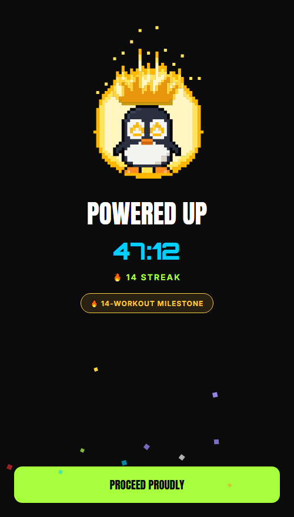

<div align="center">


# NoWomp

**The gym accountability app that doesn't let you off the hook.**

Schedule it. Show up. Or explain yourself, and let your own body fact-check the excuse.

[](LICENSE)
[](#install)
[](https://expo.dev)
[](https://reactnative.dev)
[](tsconfig.json)
[](#privacy)
[](CHANGELOG.md)
[](CONTRIBUTING.md)

<!-- After publishing to GitHub, swap akashkashyaps for the account name to light these up. -->
[](https://github.com/akashkashyaps/nowomp/releases)
[](https://github.com/akashkashyaps/nowomp/stargazers)
[](https://github.com/akashkashyaps/nowomp/issues)

[**Install**](#install) · [**Features**](#features) · [**Privacy**](#privacy) · [**Build from source**](#build-from-source) · [**Contributing**](#contributing) · [**Roadmap**](#roadmap)



</div>

---

## Why NoWomp

Most fitness apps reward you for showing up and quietly forget the days you don't. NoWomp is built around the days you don't.

- **A workout only counts if you are actually there.** Starting one checks your location against your gym or home.
- **Skipping is allowed, but never silent.** Miss a scheduled session without a word and the app locks until you explain yourself.
- **Excuses get fact-checked.** Said you were too tired? NoWomp checks last night's sleep and this morning's recovery. *"You said 'too tired' but slept 8h 12m with 84% recovery. 🤨"*
- **Everything stays on your phone.** No account, no server, no analytics, no ads.

## Features

### 🔥 Accountability core
- **Streaks** built from verified, location-checked workouts.
- **Freeze tokens**, earned every 15-workout streak, that absorb one excuse.
- **Redemption mode**: no token? Complete a workout within 48 hours to save the streak.
- **Missed-workout lock**: the app won't continue until a missed session is explained.

### 🧪 The Lab
- **Excuse fact-check**: tired, sore, busy, anxious and sick excuses are checked against sleep, recovery, steps, heart rate and your journal. Anxiety, illness and emergencies are never marked as lies.
- **Patterns**: your weakest weekday and time slot, sleep before skips, how fast you bounce back.
- **Habits → body**: how drinks, caffeine, late dinners and stress show up in the next morning's HRV, resting heart rate, sleep and recovery.
- **Best time to train**: your show-up rate by time of day.

### 🔬 Self-experiments
- Scientific **4-week ABAB experiments** (rule on, off, on, off) with a randomised start, a pre-registered main measure, daily check-ins and locked results until the end.
- A verdict only counts if it beats your own day-to-day noise *and* repeats in both rule-on weeks.
- A library of 12 templates suggested from your own data, plus **design your own**.
- Optional **AI bridge**: copy a prompt into ChatGPT or Claude, then tap the `nowomp://` link it returns to load the experiment. The app itself never calls an AI.

### 🏆 Trophies
35 hand-made pixel-art medals. Bronze, silver, gold, Lab, and a hidden **Hall of Shame** for the excuse-makers.

<div align="center">

</div>

### 📱 Home-screen widget
A penguin whose mood follows your day: hyped in the morning, impatient as the session nears, furious when you're late, crying at 9pm when the streak is genuinely at risk. Poke him and he gets annoyed.

<div align="center">

</div>

### ❤️ Health (via Health Connect)
Recovery and sleep scores calculated on-device from HRV, resting heart rate and sleep stages, plus steps, heart-rate zones, trends, a daily journal, and a weekly Sunday recap.

## Install

| Channel | Status |
|---|---|
| Google Play | Coming soon |
| GitHub Releases (APK) | Coming soon |
| Build it yourself | [See below](#build-from-source) |

**Requirements:** Android 8.0+ (API 26). Health features need [Health Connect](https://play.google.com/store/apps/details?id=com.google.android.apps.healthdata). iOS is not supported, because Health Connect is Android-only.

## Privacy

NoWomp has **no backend**. All data lives in an on-device SQLite database.

- No account, no analytics, no tracking, no ads, no third-party data SDKs.
- Health Connect data is read on-device and never leaves the phone.
- Backups are a file *you* export and store wherever you choose.
- AI features only ever copy text to your clipboard. You decide where to paste it.

Full details: [Privacy Policy](docs/privacy-policy.txt).

## Build from source

### Prerequisites
- **Node.js 22** and npm
- **JDK 17** (the one bundled with Android Studio works)
- **Android SDK** (API 36), via Android Studio
- An Android phone with USB or wireless debugging, or an emulator

### Run in development
```bash
git clone https://github.com/akashkashyaps/nowomp.git
cd nowomp
npm install
npx expo run:android     # builds the native app and starts Metro
```
The web preview (`npx expo start --web`) is handy for UI work, but Health Connect, location, notifications and the widget only work on a real Android build.

### Build a release APK
```bash
cd android
./gradlew assembleRelease -PreactNativeArchitectures=arm64-v8a
adb install -r app/build/outputs/apk/release/app-release.apk
```
Without a release keystore, the build falls back to the debug key, which is fine for your own phone. To sign properly, set `NOWOMP_UPLOAD_STORE_FILE`, `NOWOMP_UPLOAD_STORE_PASSWORD`, `NOWOMP_UPLOAD_KEY_ALIAS` and `NOWOMP_UPLOAD_KEY_PASSWORD` in `~/.gradle/gradle.properties`. Never commit a keystore.

### Checks
```bash
npx tsc --noEmit     # typecheck
npx expo lint        # lint
```

## Project structure

```
app/                 Screens (expo-router: the file path is the route)
  (tabs)/            Today, Health, Lab, You
components/          Reusable UI: tour, celebration, pixel badges, cards
constants/           Theme, excuse list, trophy and experiment definitions, pixel art
services/            All logic and data access (SQLite via expo-sqlite)
database/            Schema and migrations
widgets/             Home-screen widget (react-native-android-widget)
android/             Native project, including the workout foreground service
docs/                Privacy policy, publishing checklist, images
```

A few design rules hold across the code:
- **Pure analysis, separate from loading.** The Lab, experiment and widget-mood logic are plain functions that can be tested without a device.
- **Everything offline.** If a feature needs the network, it doesn't belong here.
- **Honest numbers.** Every verdict has to beat the user's own noise before the app claims anything.

## Roadmap

- [ ] Google Play release
- [ ] GitHub Releases with per-CPU APKs
- [ ] F-Droid listing
- [ ] Optional end-to-end-encrypted sync between devices, self-hostable

Ideas and bug reports are welcome in [Issues](https://github.com/akashkashyaps/nowomp/issues).

## Contributing

Contributions are welcome. Please read [CONTRIBUTING.md](CONTRIBUTING.md) first. In short:

1. Open an issue to discuss anything bigger than a small fix.
2. Keep the typecheck and lint clean.
3. Sign off your commits with `git commit -s` ([DCO](https://developercertificate.org/)). There's nothing to sign.

## License

NoWomp is free software, licensed under the **[GNU Affero General Public License v3.0](LICENSE)**, code and artwork alike. You may use, study, modify and share it. If you distribute a modified version, or run one for others over a network, you must release your source under the same license.

The **NoWomp name and app icon** identify the official app, so forks should use their own. See [TRADEMARKS.md](TRADEMARKS.md).

<div align="center">

**Made with stubbornness. No womp today.** 🐧🔥

</div>
